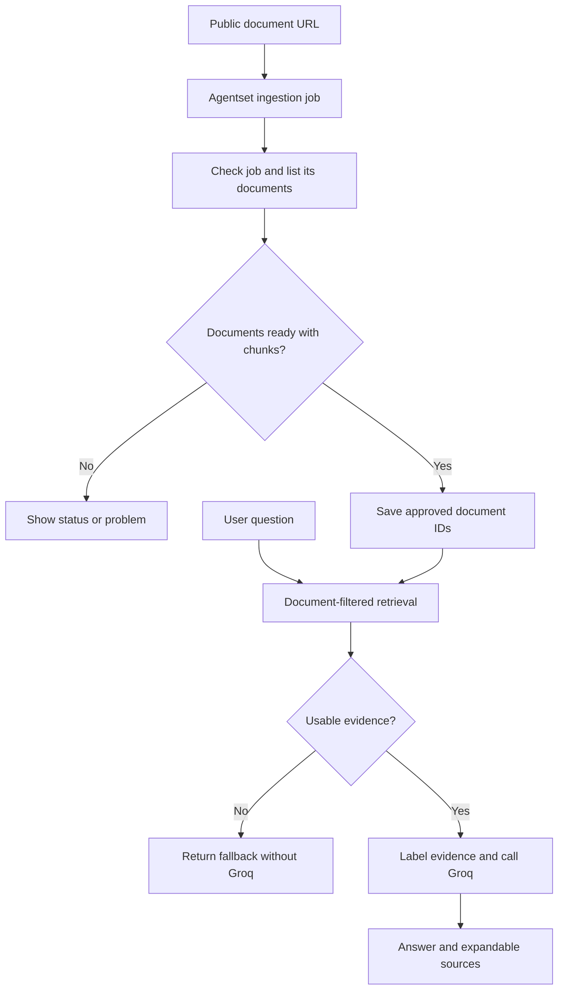

# Document Q&A — Agentset, Groq and Streamlit

A local learning MVP that accepts a public document URL and answers questions using retrieved passages from that submission. Answers include source labels and expandable evidence; unsupported questions should receive an insufficient-evidence response.

Built as a managed-RAG learning project inspired by [RAG as a Service](https://github.com/Shubhamsaboo/awesome-llm-apps/tree/main/rag_tutorials/rag-as-a-service). This implementation uses Agentset and Groq rather than the reference project's Ragie and Claude.

## Features

- Submit a public URL through Streamlit using Agentset's CRAWL ingestion mode.
- Save the ingestion job in browser-session state and check status manually.
- Find documents associated with that exact job, including paginated results.
- Check document completion, reported failures and positive chunk counts.
- Restrict retrieval to approved document IDs; validate ownership of returned chunks.
- Prepare labelled passages, generate an answer with Groq and display source evidence.
- Return a fallback when no usable evidence exists or the requested fact is unsupported.
- Handle HTTP failures separately from valid empty search results.

## Architecture



Agentset manages document processing, chunking, embeddings and search. Python coordinates the workflow. Groq generates answers; it does not choose tools or autonomously plan actions. This is a RAG workflow, not an autonomous agent.

## Components

| File | Responsibility | Category |
| --- | --- | --- |
| app.py | Forms, session state, status display and document-scoped Q&A | UI / orchestration |
| ingestion.py | Create jobs, read status and list documents belonging to a job | HTTP integration |
| readiness.py | Evaluate document processing readiness | Deterministic validation |
| retrieval.py | Search with optional document restrictions and validate source ownership | HTTP integration |
| evidence.py | Build labelled evidence and preserve source mappings | Data preparation |
| generation.py | Send evidence and question to Groq | LLM integration |
| pipeline.py | Coordinate retrieval, evidence, fallback and generation | Orchestration |
| test_*.py | Component and integration checks used during development | Manual test scripts |

## Tested local environment

- Python 3.11.5
- requests 2.34.2
- Streamlit 1.66.1
- Windows PowerShell
- Groq model: openai/gpt-oss-20b

These versions were reported from the working local environment. A clean-environment reinstall has not yet been verified. The project uses requests directly rather than Agentset or Groq SDKs.

## Setup

### 1. Create a virtual environment

Open PowerShell in the folder containing app.py:

```powershell
python -m venv .venv
.\.venv\Scripts\Activate.ps1
python -m pip install requests==2.34.2
python -m pip install streamlit==1.66.1
```

Install dependencies one at a time so failures are easier to identify. Do not commit .venv or __pycache__.

### 2. Configure service access

Create an Agentset account, a namespace and an API key with access to that namespace. Create a Groq API key. Account setup, quotas, available models and costs depend on each provider's current terms; this app does not enforce a spending cap.

Set credentials in the same PowerShell session that launches Streamlit:

```powershell
$env:AGENTSET_API_KEY = "YOUR_AGENTSET_API_KEY"
$env:GROQ_API_KEY = "YOUR_GROQ_API_KEY"
```

The application reads environment variables with os.environ. It does not automatically load a .env file. These PowerShell settings apply to the current shell and its child processes.

In app.py, change the existing namespace_id assignment to your own namespace ID. Several development scripts also contain namespace IDs and sample job/document IDs; update those before reusing the scripts with another account.

Never commit API keys or share a terminal transcript containing them.

### 3. Start the app

```powershell
python -m streamlit run app.py
```

Open the local URL printed in the terminal.

## Usage

1. Paste a public document URL and click Add document once.
2. Click Check status until document readiness passes.
3. Enter a question and click Ask.
4. Expand the retrieved sources and verify that cited passages support the answer.
5. Ask further questions without submitting the URL again.

Job and document IDs are internal tracking details, available under Technical details for debugging. Users do not need to copy them.

Every new submission clears the previous approved document selection. The application saves state for the current Streamlit session; reconnecting or restarting can lose the selection. Losing local session state does not delete documents stored in Agentset.

## Important implementation choices

- URL ingestion uses a CRAWL payload with a url field. During development, the same test PDF failed through FILE URL ingestion but worked through CRAWL. This observation does not establish that FILE is generally broken.
- Search requests up to five chunks and includes metadata, with a 30-second request timeout.
- Document API IDs observed in testing had a doc_ prefix, while searchable metadata omitted it. retrieval.py normalizes the leading prefix for filtering and ownership checks.
- Passing no document_ids to retrieval/pipeline preserves namespace-wide behaviour for older development scripts. The Streamlit question flow always supplies approved IDs.
- Groq uses low reasoning effort, a 1,024-completion-token limit and a 60-second request timeout.
- Sources returned by the pipeline include all passages supplied to generation, not only the passages the model cited.
- The prompt requires evidence-only answers, citations and refusal when requested facts are absent. It instructs the model to treat document content as data.

## Validation performed

Manual checks reported successful during development:

| Test | Observed outcome |
| --- | --- |
| Direct dummy-PDF URL with CRAWL | Completed and extracted Dummy PDF file |
| Job-to-document lookup | Returned the document associated with the requested job |
| Readiness | Verified completion, no reported failure and one chunk |
| Restricted retrieval | Returned the selected PDF's chunk, excluding duplicate copies |
| Supported dummy-PDF question | Correct text with an S1 citation |
| IPL question while dummy PDF selected | Insufficient-evidence response; only dummy-PDF evidence |
| RFC 2606: four reserved top-level names | Expected answer reported by tester |
| RFC 2606: purpose of .invalid | Correct answer with citation; RFC sources displayed |
| RFC 2606: unsupported writing budget | Expected refusal reported by tester |
| RFC 2606: unrelated IPL question | Expected refusal reported by tester |

Meaningful-document test URL:
https://www.rfc-editor.org/rfc/rfc2606.txt

The checks are a small manual acceptance set, not an automated reliability benchmark or proof that every citation is correct. Earlier model runs showed false refusals and citation-format variability; a prompt clarification passed subsequent checks.

Useful scripts include test_ingestion_function.py, test_ingestion_status.py, test_job_documents.py, test_document_retrieval.py, test_generation_function.py and test_pipeline_function.py. Inspect their configured inputs first: some intentionally use fixed evidence, old questions or sample IDs. They may make live API calls and are not a hermetic unit-test suite.

## Known limitations

- Public URL access is required. Google Drive preview links produced sign-in text; a Kaggle dataset page produced no chunks. Preview URLs are not equivalent to direct document content.
- A completed job and positive chunk count do not prove useful content. Readiness does not detect sign-in pages, misleading text or incorrect extraction.
- CRAWL behaviour can vary by site and may produce multiple documents. Inspect the resulting document scope; the app approves the documents associated with the submission.
- Top-five retrieval may omit relevant evidence. Full-document summaries, totals and exhaustive analysis are not guaranteed.
- Model answers can omit citations, refuse supported questions or make unsupported claims. Prompt instructions are not a deterministic guarantee.
- There is no authentication, per-user tenant isolation, durable application database, chat memory or deployment setup.
- The session stores the current selection, not a durable document library UI.
- Repeated Add document submissions can create duplicates; there is no deduplication or automatic cleanup.
- Ingestion submission is not retried automatically. A request timeout may occur after a job was created; inspect Agentset before resubmitting.
- Prompt-injection resistance is instruction-based, not a complete security boundary.
- Provider availability, quotas and errors affect latency and reliability.

## Troubleshooting

| Symptom | Check |
| --- | --- |
| Missing API key message | Set credentials in the launching terminal and restart Streamlit |
| 404 checking a job | Confirm the complete job_ ID and correct namespace |
| COMPLETED but no useful evidence | Inspect document chunks, not only job status |
| Sign in or viewer text in chunks | Replace the preview URL with an accessible source document |
| Zero chunks with a document filter | Inspect metadata.documentId and API/search ID normalization |
| Correct evidence but refusal | Confirm question and prepared evidence, then inspect generation policy |
| Ask disabled | Click Check status and inspect document readiness |
| Job Config shows {} | This is configuration, not extracted content; use Documents → Chunks → View |

## Completion status

The core local learning MVP and a small manual full-workflow acceptance set are complete. Clean-install verification, broader evaluation, production hardening and deployment remain separate work.

## Learning outcomes

The project demonstrates managed RAG integration, API boundaries, asynchronous ingestion jobs, state management, document ownership, retrieval filtering, evidence-based prompts, refusal testing and debugging by isolating components.

